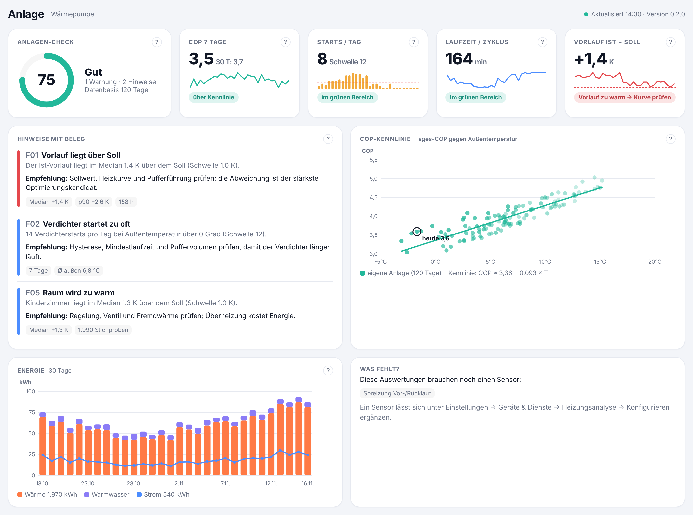
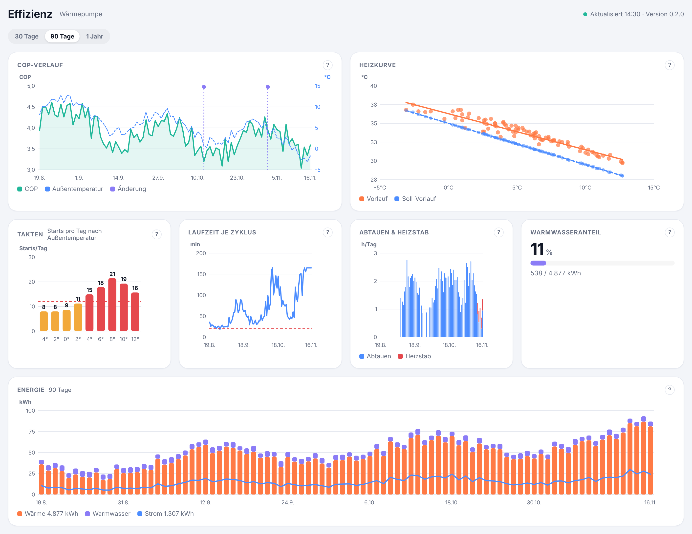
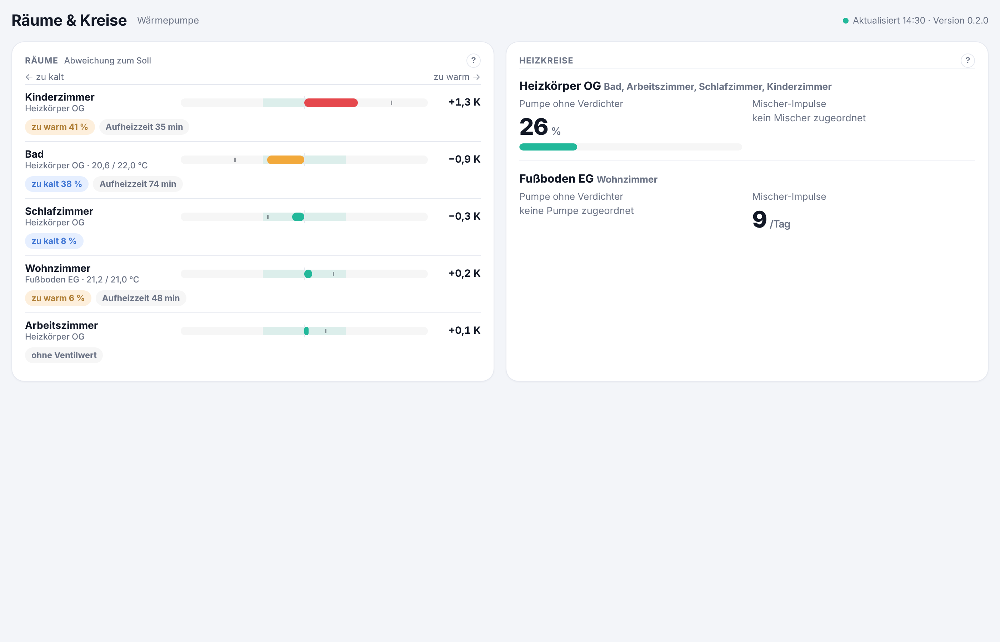
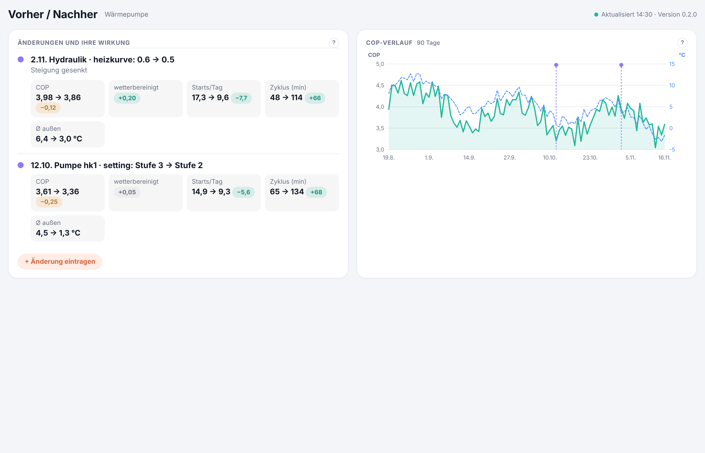
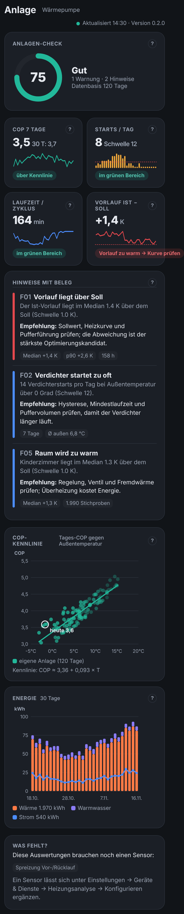

# Heizungsanalyse

Home-Assistant-Custom-Integration zur **reinen Beobachtung und Auswertung**
einer Wärmepumpenheizung. Sie liest vorhandene Entities und
Recorder-Statistiken, berechnet Kennzahlen (COP, Taktung, Vorlauf-Abweichung,
Raumkomfort, Pumpen- und Mischerverhalten) und leitet Hinweise mit Beleg ab.

**Die Integration steuert nichts.** Es gibt keinen Schreibzugriff auf
Wärmepumpe, Heizkreise, Thermostate oder Pumpen. Der einzige Schreibpfad ist
das integrationseigene Inventar (Stammdaten, Änderungsverlauf, Roll-ups); ein
Test prüft den Quelltext auf steuernde Aufrufe.

## Dashboard

Nach der Einrichtung legt die Integration das Dashboard **Heizungsanalyse**
selbst an (Seitenleiste) – fünf Ansichten, keine Entity-Namen von Hand, mit
„?“-Erklärung an jeder Kachel, hell und dunkel, auf Deutsch und Englisch.



| Effizienz | Räume & Kreise |
|---|---|
|  |  |
| **Vorher / Nachher** | **Handy, dunkel** |
|  |  |

Bilder mit Beispieldaten. Details: [Dashboard](docs/dashboard.md).

## Status

Version 0.2.1. Alle Analysestufen sind vorhanden: Repo-Gerüst (M0),
Einrichtung (M1), Kennzahlen (M2), Inventar und Dienste (M3), Raum- und
Kreisanalyse (M4), Findings (M5), Doku (M6), die dokumentierte Schnittstelle
zu raumklima-2 (M7) und das selbst angelegte Dashboard (M8–M12).
Veröffentlicht als `Goldi5/Heizungsanalyse`; CI mit ruff, pytest, hassfest,
HACS-Validierung und Dashboard-Tests (Node).

| Phase | Inhalt | Stand |
|---|---|---|
| M0 | Repo-Gerüst, CI, leere Integration | erledigt |
| M1 | Config-Flow, Entity-Mapping, Kreis- und Raum-Modell | erledigt |
| M2 | Kennzahlen (COP, Starts, Laufzeit, Vorlauf) | erledigt |
| M3 | Geräteinventar, Änderungsverlauf, Services | erledigt |
| M4 | Raum- und Kreisanalyse | erledigt |
| M5 | Findings-Engine | erledigt |
| M6 | Doku, Dashboard-Beispiel, Release 0.1.0 | erledigt |
| M7 | Zusammenspiel mit raumklima-2 | erledigt (Doku + Isolationstest) |
| | Release 0.1.1 auf GitHub | erledigt |
| M8 | Frontend-Bündel, Strategie, Ressource automatisch | erledigt (0.2.0) |
| M9 | Dashboard legt sich selbst an | erledigt (0.2.0) |
| M10 | Websocket `summary` – alle Daten in einem Aufruf | erledigt (0.2.0) |
| M11 | Fünf Ansichten: Anlage, Effizienz, Räume & Kreise, Vorher/Nachher, Inventar | erledigt (0.2.0) |
| M12 | „?“-Hilfe, Hell/Dunkel, DE/EN, Handy-Layout | erledigt (0.2.0) |

## Voraussetzungen

- Home Assistant ab 2025.10 (siehe `hacs.json`).
- Recorder mit Langzeitstatistik für die gemappten Zähler (Standard).
- Quellen: WP-Strom (kWh), WP-Heizwärme (kWh), Außentemperatur,
  Verdichter-Status. Alles Weitere ist optional.

## Installation (HACS, benutzerdefiniertes Repository)

1. HACS öffnen, Integrationen, Drei-Punkte-Menü, *Benutzerdefinierte
   Repositories*.
2. URL dieses Repositories eintragen, Kategorie *Integration*.
3. Installieren und Home Assistant neu starten.
4. *Einstellungen, Geräte und Dienste, Integration hinzufügen,
   Heizungsanalyse*.

Ohne HACS: Ordner `custom_components/heizungsanalyse` nach
`config/custom_components/` kopieren und neu starten.

## Einrichtung

1. **Pflichtquellen** im Einrichtungsdialog wählen: Strom, Heizwärme,
   Außentemperatur, Verdichter-Status. Einheit, Geräteklasse und Verfügbarkeit
   werden geprüft; unpassende Entities werden abgelehnt.
2. **Optionen** (*Konfigurieren*): Ersatzstromquelle, Warmwasserwärme,
   Vorlauf/Soll-Vorlauf, Rücklauf, Puffer, Abtauung, Heizstab,
   Verdichterstarts und -laufzeit.
3. **Heizkreise** anlegen: Name, Typ, optional Ist-Temperatur, Pumpe, Mischer.
4. **Räume** anlegen: Name, Kreis, optional Climate-Entity und Ventilposition.
   Die Zuordnung Kreis zu Raum bestätigt immer der Nutzer; die Integration
   rät sie nie aus Entity-Namen. Räume ohne Regelung (Heizung dauerhaft aus)
   werden ohne Climate-Entity angelegt und lösen keine Raumhinweise aus.
5. **Schwellen** der Hinweise prüfen (*Konfigurieren, Schwellen der Hinweise*).

Die Zuordnung der Pflichtquellen lässt sich über *Neu konfigurieren*
ändern.

## Entities, Dienste, Hinweise

- [Entities](docs/entities.md): Sensoren, Attribute, Datenfenster.
- [Dienste](docs/services.md): Inventar pflegen, Zeiträume vergleichen,
  Bericht exportieren.
- [Hinweise](docs/findings.md)
- [Zusammenspiel mit raumklima-2](docs/raumklima-2.md): Regeln F01 bis F13, Schwellen, Grenzen.
- [Dashboard](docs/dashboard.md) – legt sich selbst an; ein YAML-Beispiel für
  eigene Karten bleibt in [dashboard-example.yaml](docs/dashboard-example.yaml).

## Grenzen

- Hinweise ersetzen keine Fachbetrieb-Beratung und keine
  Herstellerdokumentation.
- Ohne ausreichende Datenbasis gibt die Integration `unknown` aus statt zu
  schätzen. Fehlende Quellen erzeugen keine Kennzahl und kein Finding.
- Kennlinien (COP gegen Außentemperatur, Heizkurve) füllen sich erst über
  eine Heizperiode.
- Raum- und Kreiswerte sind Stichproben im Fünf-Minuten-Takt und leben im
  Arbeitsspeicher; nach einem Neustart füllen sie sich neu.
- Livisi-Thermostate liefern keine Ventilposition. Raumkennzahlen nutzen dann
  nur Soll und Ist; ein hydraulischer Abgleich lässt sich damit nicht
  nachweisen.

## Datenschutz

Keine Klarnamen, UUIDs oder Standortdaten in Code, Tests, Fixtures oder
Diagnostics. Diagnostics enthält nur Zähler, Domänen und Kennzahlen; siehe
`custom_components/heizungsanalyse/diagnostics.py`.

## Entwicklung

```bash
python3.13 -m venv .venv
.venv/bin/pip install -r requirements_test.txt
.venv/bin/ruff check custom_components tests
.venv/bin/ruff format --check custom_components tests
.venv/bin/pytest tests -q -p no:logging

# Dashboard (Quelltext in frontend/src, gebaut nach www/heizungsanalyse-card.js)
cd frontend && npm ci && npm test && npm run build
```

CI führt zusätzlich `hassfest` und die HACS-Validierung aus
(`.github/workflows/validate.yml`). Beide brauchen das GitHub-Repo.

## Lizenz

MIT, siehe [LICENSE](LICENSE).
